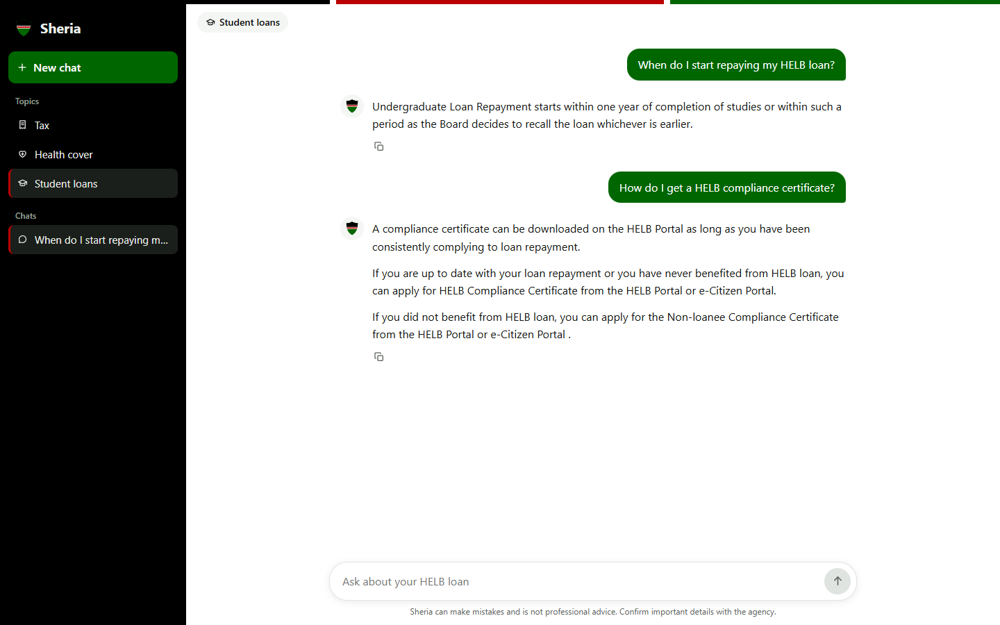
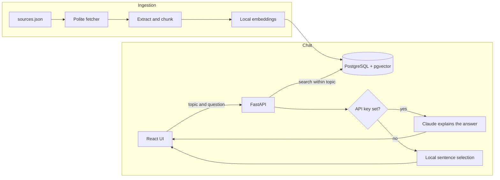

# Sheria RAG

A chatbot for Kenyan tax, health-cover and student-loan rules. You choose a topic (Tax, SHA or HELB), ask a question in plain language, and it answers from official KRA, SHA and HELB guidance. *Sheria* is Swahili for "law".

It is built around one rule: answer only from the official pages, and say so when they do not cover a question.



**Screenshots:** the topic picker, answers for each topic, a question outside the guidance and the phone layout are in [docs/SCREENSHOTS.md](docs/SCREENSHOTS.md) (also as a [Word document](docs/Sheria_RAG_Screenshots.docx)).

## How it works



| Folder | Responsibility |
|---|---|
| `backend/app/` | Fetching, extraction, embeddings, retrieval, answers and the API |
| `backend/sources.json` | The official pages to ingest, with a content selector for each site |
| `backend/eval/` | Labelled questions for the retrieval and answer tests |
| `backend/tests/` | Tests, run against a real PostgreSQL with pgvector |
| `frontend/` | React chat interface in the colours of the Kenyan flag |

## Two answer modes

| | With `ANTHROPIC_API_KEY` | Without a key |
|---|---|---|
| **How** | Claude writes an explanation from the retrieved passages | Picks the sentences closest to the question |
| **Answers read like** | A plain-language explanation | The official wording, quoted |
| **Cost** | Paid per question | Free, runs on your machine |
| **Off-topic questions** | The model is told to decline | Declined when similarity is below a threshold |
| **Status** | Tested with a fake client only | Tested on real pages (below) |

## Design decisions

- **The topic comes first.** Search only looks inside the chosen field, so a tax question cannot pull in HELB text.
- **Embeddings run locally** (`BAAI/bge-small-en-v1.5` through fastembed), so ingestion and search need no paid API.
- **PostgreSQL does the vector search.** One database holds documents, chunks and embeddings.
- **The vector index looks further when filtering.** HNSW filters after it scans, so a small agency could otherwise come back with too few passages.
- **Ingestion is safe to repeat.** Unchanged pages are skipped, changed pages are replaced in one transaction, and a failed or empty download never removes stored content.
- **A content selector that matches nothing is an error.** An early version fell back to the whole page and stored a navigation menu as if it were guidance.
- **Passages are treated as data.** They come from web pages, so the prompt separates them from the question and tells the model to ignore any instructions inside them.
- **Local answers look at the shape of the question.** Similarity alone cannot tell that "when" wants a time, so sentences stating a time or an amount get a bonus on those questions.
- **Sources are not shown.** Answers stay short and direct, so the line under the composer tells people to confirm important details with the agency.

## Test results

### Answers

`python -m app.evaluate_answers` asks 25 questions through the local mode and checks that each answer contains the expected fact, or declines when it should. **23 of 25 pass**, including all 5 questions that should be declined, such as a HELB question asked under Tax. The two failures:

- "Who must register with SHA?" answers how to register, not who must.
- "Which students can get undergraduate loans?" leads with application types.

This set was also used to tune the local mode, so 23 of 25 is not an independent score. The check only looks for a key fact in the text, so it does not measure how well an answer reads.

### Retrieval

`python -m app.evaluate` runs 44 labelled questions and checks whether a passage from the correct document was retrieved. Hit@12 matters most, because the answer step reads twelve passages.

| Search | Hit@1 | Hit@12 | MRR |
|---|---|---|---|
| **Vector (default)** | 0.84 | 0.98 | 0.88 |
| Hybrid, text weight 0.1 | **0.86** | 0.98 | **0.89** |
| Hybrid, text weight 1.0 | 0.75 | **1.00** | 0.84 |
| Full-text only | 0.55 | 0.95 | 0.66 |

I expected hybrid search to win clearly, and built it first. It did not. Equal-weight fusion finds one more document but ranks far worse at the top, because matching any word of a question brings in noise. Lowering the weight only brought it level with vector search. The gaps at the top are one question each, so vector search stays the default because it is simpler. Hybrid is available through the `mode` argument of `search`.

I wrote these questions myself after reading the pages, the set is small, and the text weight was chosen on the same questions.

## Running it

You need Python 3.12, Node.js 20+ and PostgreSQL with the [pgvector](https://github.com/pgvector/pgvector) extension.

```bash
cd backend
python -m venv .venv
.venv/Scripts/activate            # macOS or Linux: source .venv/bin/activate
pip install -r requirements-dev.txt
cp .env.example .env              # then set DATABASE_URL, and ANTHROPIC_API_KEY if you have one
python -m app.ingest              # downloads the pages and builds the index
uvicorn app.main:app --port 8000
```

```bash
cd frontend
npm install
npm run dev                       # http://localhost:5173
```

Run the checks with `pytest` and `ruff check .` in `backend/`, and `npm test` in `frontend/`. Without `TEST_DATABASE_URL`, the tests start an embedded PostgreSQL with pgvector, so they need no setup.

## Limitations

- **Local answers quote, they do not explain.** Without a key the chatbot returns official sentences, which can read stiffly or include a stray line from a list. Plain-language explanations need the API key.
- **Answers with Claude are untested against the live API.** Tests use a fake client.
- **The sources are summaries, not the law.** The Kenya Law website does not serve automated clients, so the Acts themselves are not included, and the KRA pages can lag behind a new Finance Act.
- **There are gaps.** The SHA contribution rate is not in the pages that can be fetched, and the SHA FAQ page loads through JavaScript, so the chatbot declines those questions.
- **Each question stands alone.** A follow-up such as "and for landlords?" is not read with the question before it.
- **Chats last until the page is reloaded.** Nothing is stored between visits.
- **It is not advice.** Confirm anything important with the agency or a qualified professional.
