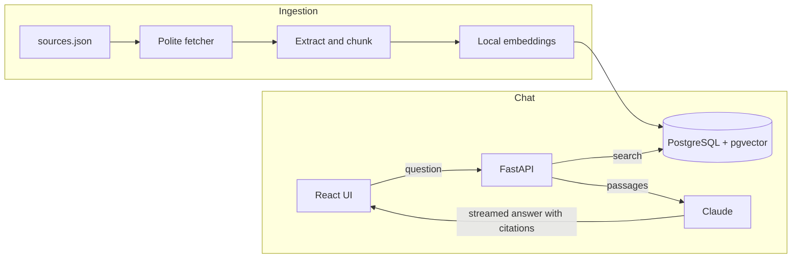

# Sheria RAG

A question-answering assistant for Kenyan tax, health-cover and student-loan rules. It searches official KRA, SHA and HELB guidance, then writes a short answer in which every claim links back to the passage it came from. *Sheria* is Swahili for "law".

The answer is only as good as the sources, so the project is built around three rules: answer from retrieved passages only, say so when they do not cover a question, and show the reader the original source.

## How it works



| Folder | Responsibility |
|---|---|
| `backend/app/` | Fetching, extraction, embeddings, retrieval, answer generation and the API |
| `backend/sources.json` | The official pages to ingest, with a content selector for each site |
| `backend/eval/` | Labelled questions for the retrieval benchmark |
| `backend/tests/` | Tests, run against a real PostgreSQL with pgvector |
| `frontend/` | React chat interface |

## Design decisions

- **Embeddings run locally** (`BAAI/bge-small-en-v1.5` through fastembed), so ingestion and search need no paid API and no key.
- **PostgreSQL does the vector search.** One database holds documents, chunks and embeddings, so there is no separate vector store to keep in sync.
- **Chunks follow the page's headings**, so a passage keeps the section it came from.
- **Ingestion is safe to repeat.** Unchanged pages are skipped, changed pages are replaced in one transaction, and a failed or empty download never removes stored content.
- **A content selector that matches nothing is an error.** An early version fell back to the whole page and stored a navigation menu as if it were guidance.
- **Citations are checked.** A citation number that does not match a supplied passage never becomes a link.
- **Passages are treated as data.** They come from web pages, so the prompt separates them from the question and tells the model to ignore any instructions inside them.
- **It works without an API key.** With no key, the API returns the closest official passages instead of a written answer.

## Retrieval results

`python -m app.evaluate` runs 44 labelled questions and checks whether a passage from the correct document was retrieved. Hit@6 matters most, because the model reads six passages.

| Search | Hit@1 | Hit@6 | MRR |
|---|---|---|---|
| **Vector (default)** | 0.84 | **0.98** | 0.88 |
| Hybrid, text weight 0.1 | **0.86** | 0.95 | **0.89** |
| Hybrid, text weight 1.0 | 0.75 | 0.93 | 0.83 |
| Full-text only | 0.55 | 0.84 | 0.64 |

I expected hybrid search to win, and built it first. It did not: equal-weight fusion was clearly worse, because matching any word of a question brings in noise. Lowering the weight only brought it level with vector search, and on the 10 keyword-style questions every configuration tied, so exact terms such as `TCC` and `ECCIF` did not need full-text search either. Vector search is the default because it is simpler and scored best on Hit@6. Hybrid stays available through the `mode` argument of `search`.

Read these numbers with care. I wrote the questions myself after reading the pages, the set is small (one question is worth about 0.02), and the text weight was chosen on the same questions it is reported on. They measure whether the right document was found, not whether a written answer is correct.

## Running it

You need Python 3.12, Node.js 20+ and PostgreSQL with the [pgvector](https://github.com/pgvector/pgvector) extension.

```bash
cd backend
python -m venv .venv
.venv/Scripts/activate            # macOS or Linux: source .venv/bin/activate
pip install -r requirements-dev.txt
cp .env.example .env              # then set DATABASE_URL, and ANTHROPIC_API_KEY for written answers
python -m app.ingest              # downloads the pages and builds the index
uvicorn app.main:app --port 8000
```

```bash
cd frontend
npm install
npm run dev                       # http://localhost:5173
```

Run the checks with `pytest` and `ruff check .` in `backend/`, and `npm test` in `frontend/`. Without `TEST_DATABASE_URL`, the tests start an embedded PostgreSQL with pgvector, so they need no setup.

## Limitations

- **The sources are summaries, not the law.** The Kenya Law website does not serve automated clients, so the Acts themselves are not included. The KRA pages can lag behind a new Finance Act.
- **There are gaps.** Some answers are missing from the pages that can be fetched. For example, the SHA contribution rate is not in the ingested text, and the SHA FAQ page loads through JavaScript, so it is not included. The assistant should say it does not know, but no rate will be found.
- **Off-topic questions still retrieve passages.** Search always returns its closest matches, so declining an unrelated question depends on the model following its instructions. In passages-only mode, an unrelated question simply shows weak matches.
- **Written answers are untested against the live API.** Tests use a fake client, and the interface was checked with a simulated stream. Answer quality has not been measured.
- **It keeps no conversation history.** Each question stands alone.
- **It is not advice.** Confirm anything important with the agency or a qualified professional.
