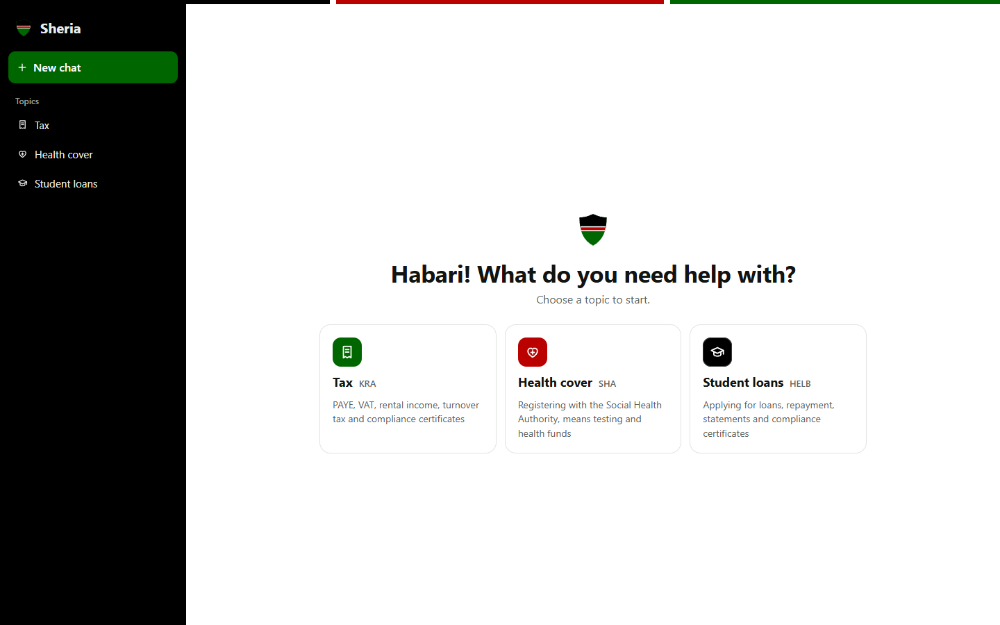
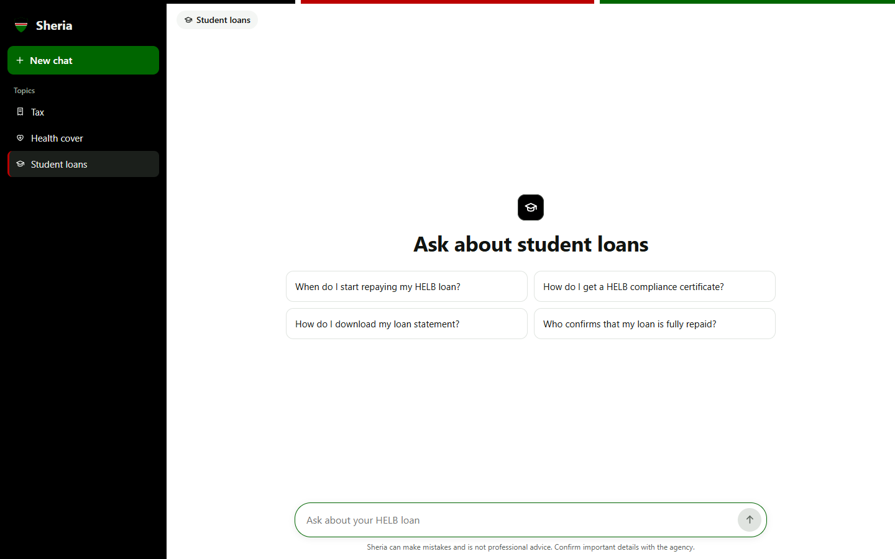
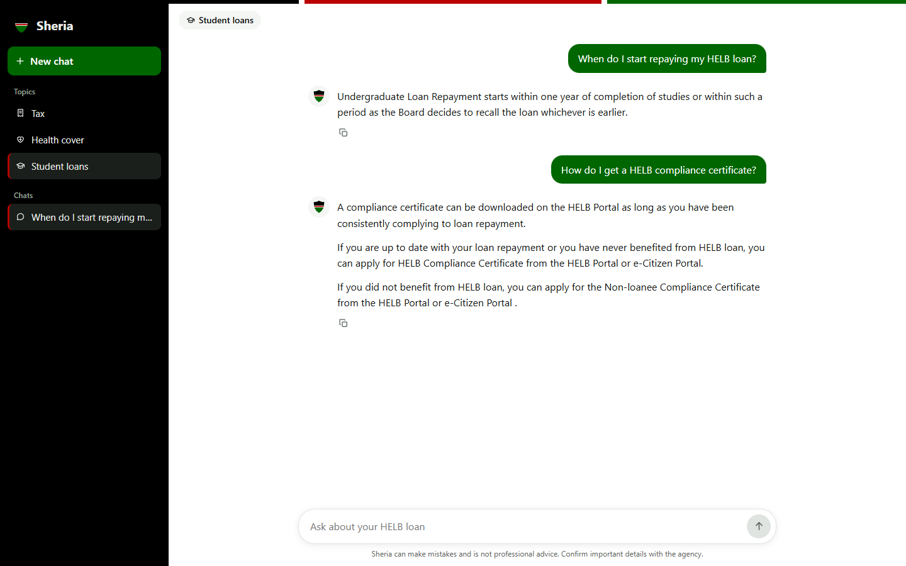
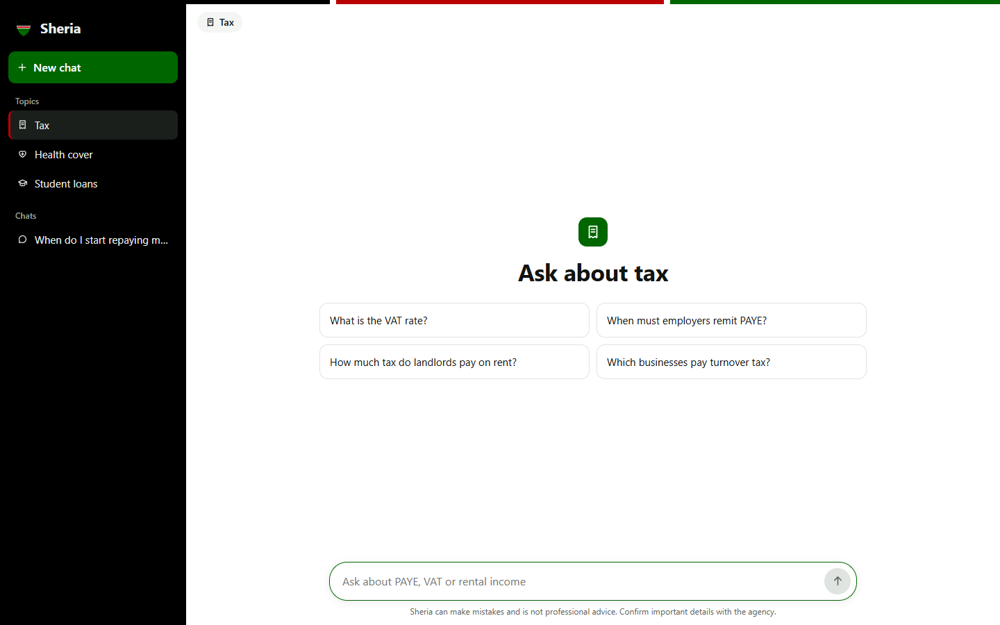
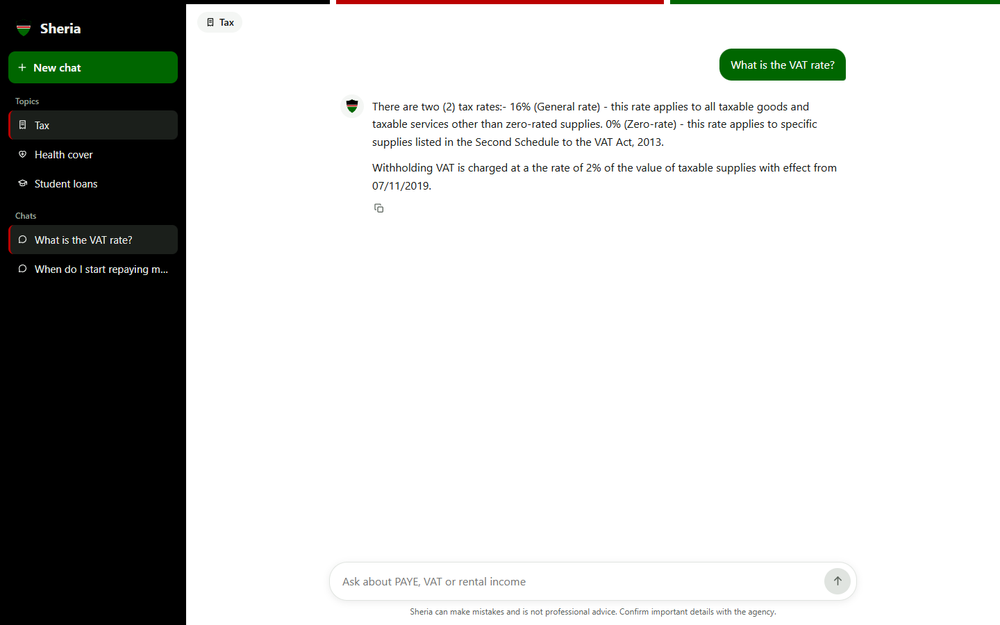
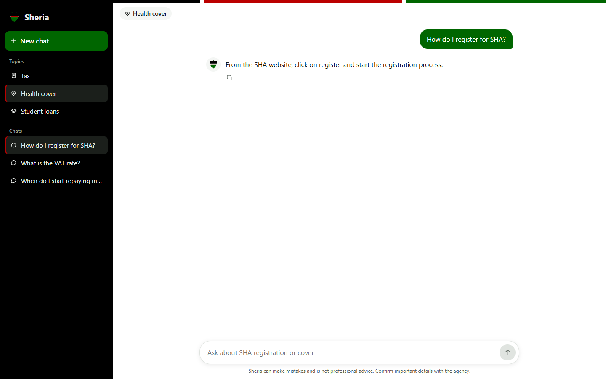
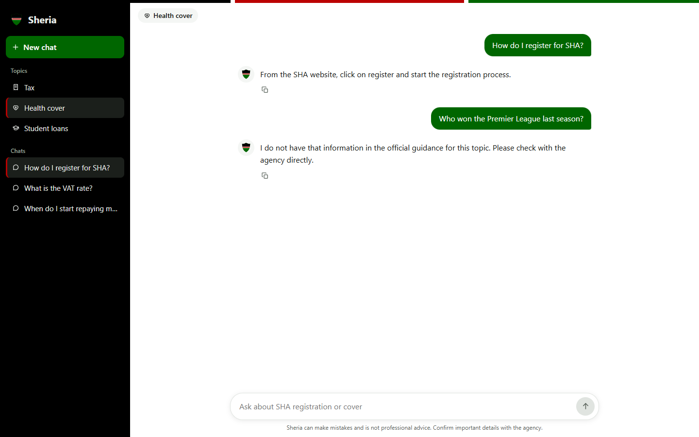
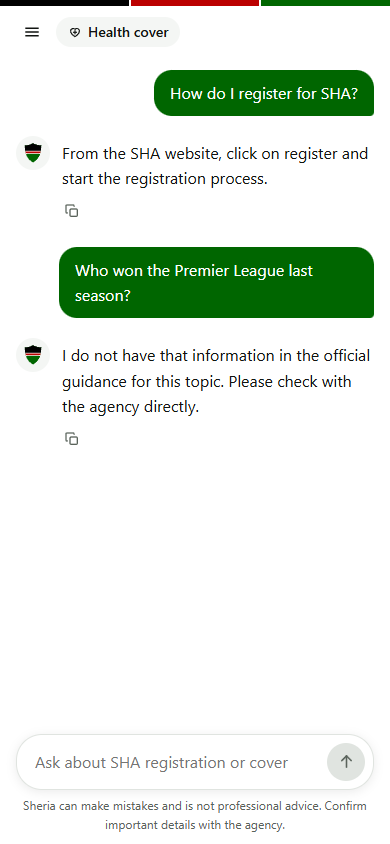

# Sheria RAG: system screenshots

A chatbot that answers questions about Kenyan tax (KRA), health cover (SHA) and student loans (HELB) from official guidance only.  
Screenshots taken on 10 November 2026 from the running system.  

The same screenshots are in the Word document [Sheria_RAG_Screenshots.docx](Sheria_RAG_Screenshots.docx).

## About this document

Every figure was taken from the running chat app at 1440 by 900 pixels, except the last, which shows the same app on a phone-sized screen. The search index held 20 official KRA, SHA and HELB pages, built with python -m app.ingest. Each figure is numbered and has a short description.

These screenshots show the app without an Anthropic API key. In that mode Sheria does not write its own explanation: it answers with the sentences from the official pages that are closest to the question, quoted as they are, and declines when nothing is close enough. With a key, the same retrieved passages are given to Claude, which explains them in plain language. The interface is the same in both modes.

The questions were asked as a user would: by choosing a topic, then clicking a suggested question or typing one.

### List of figures

1. Choose a topic
2. Student loans: suggested questions
3. Student loans: two answers
4. Tax: suggested questions
5. Tax: the VAT rate
6. Health cover: registering for SHA
7. A question outside the guidance
8. On a phone

## 1. Choosing a topic

Sheria asks for the topic before the question, so it only searches the guidance for that agency.

### Choose a topic

The start screen. The user picks Tax (KRA), Health cover (SHA) or Student loans (HELB), with a line under each saying what it covers. The same topics are in the sidebar, and the strip at the top uses the colours of the Kenyan flag.

*Figure 1: Choose a topic*

### Student loans: suggested questions

After choosing a topic, Sheria offers common questions for it. The user can click one or type their own question in the box, whose hint changes with the topic.

*Figure 2: Student loans: suggested questions*

## 2. Asking questions

Each answer comes from the official pages for the chosen topic. Sources are not shown in the chat, so answers read as a conversation.

### Student loans: two answers

Two HELB questions in one conversation: when repayment starts, and how to get a compliance certificate. Each answer has a copy button, and the conversation appears under Chats in the sidebar.

*Figure 3: Student loans: two answers*

### Tax: suggested questions

The Tax topic suggests questions about VAT, PAYE, rental income and turnover tax.

*Figure 4: Tax: suggested questions*

### Tax: the VAT rate

The answer gives both VAT rates, 16% and 0%, and when each applies, plus the 2% withholding VAT, quoted from KRA's guidance.

*Figure 5: Tax: the VAT rate*

### Health cover: registering for SHA

A question about registering with the Social Health Authority, answered from SHA's own guidance.

*Figure 6: Health cover: registering for SHA*

## 3. Staying within the official guidance

Sheria is built around one rule: answer only from the official pages, and say so when they do not cover a question.

### A question outside the guidance

Asked about football in the Health cover topic, Sheria does not guess. It says the official guidance does not cover the question and points the user to the agency.

*Figure 7: A question outside the guidance*

### On a phone

The same conversation on a phone-sized screen. The sidebar folds into the menu button at the top left, and the reminder that Sheria is not professional advice stays under the message box.

*Figure 8: On a phone*
